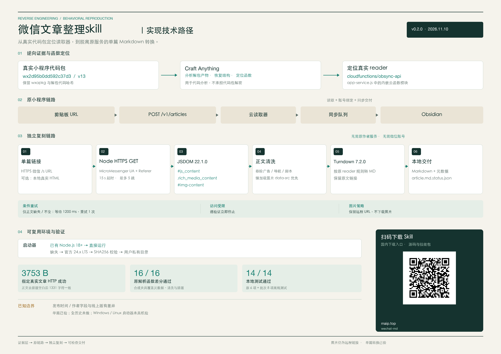
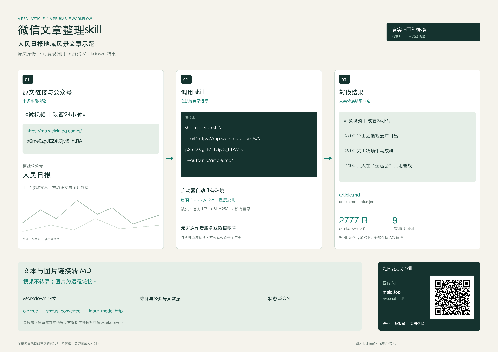

# 微信文章整理skill

根据「Obsidian同步助手」实际 v13 小程序代码包逆向，复刻其中微信文章读取、正文清洗与 Markdown 转换规则。核心是 JSDOM + 微信正文选择器 + Turndown 7.2.0；[证据与差异](references/reverse-evidence.md)记录了实际函数与限制。



下载完整发布包、解压即可运行。启动器自动检测 Node.js；缺失时从官方源下载、校验并安装到用户私有目录。转换依赖已打包，无需 npm 安装：

```sh
sh scripts/run.sh --url 'https://mp.weixin.qq.com/s/文章ID' --output './output/文章.md'
```

Windows PowerShell：

```powershell
& .\scripts\run.ps1 --url "https://mp.weixin.qq.com/s/文章ID" --output ".\output\文章.md"
```

[完整环境检测、自动安装与故障处理教程](references/environment.md)包含系统要求、下载校验、安装位置和手动准备方法。已有 Node.js 18+ 时也可直接运行 `node scripts/wechat-to-md.cjs ...`。

## 作为 Skill 安装

从 [v0.4.0 发布页](https://github.com/dashizhihuan2018-source/wechat-article-to-md-skill/releases/tag/v0.4.0) 下载 ZIP，解压得到 `wechat-article-to-md-skill` 文件夹。`.skill` 附件也是同内容 ZIP，供支持该格式的技能管理器导入。

Codex 用户将文件夹复制到以下目录，确认 `SKILL.md` 直接位于该文件夹内，再重新打开会话：

- macOS / Linux：`~/.codex/skills/wechat-article-to-md-skill/`
- Windows：`%USERPROFILE%\.codex\skills\wechat-article-to-md-skill\`

对智能体说：“使用 $wechat-article-to-md-skill，把这个微信文章链接保存为 Markdown：……”即可。无需绑定 Obsidian 或提供原作者服务的账号；输出目录由使用者指定。其他支持 `SKILL.md` 的智能体可按其技能目录约定放置同一文件夹。

也可转换已正常取得的真实 HTML：

```sh
node scripts/wechat-to-md.cjs --url 'https://mp.weixin.qq.com/s/文章ID' --html './page.html' --output './output/文章.md'
```

成功写入 Markdown 和状态文件，例如 `文章.md` 与 `文章.md.status.json`；图片仍为远程 URL。退出码0表示转换成功，2表示需要验证或访问受限，1表示其他失败。输出路径须不存在。

2026-11-10，最终运行包已直接通过 HTTP 读取指定真实微信文章并生成 3,753 字节 Markdown；与原小程序保存结果相比，正文移除排版空白后完全一致（1,331字符）。16例原解析函数差分和15项本地测试全部通过。作者、发布时间等元数据与线上版仍有差异，详见[验证记录](references/reverse-evidence.md#真实单篇验证)。

微信可能向本机请求返回验证页。遇到验证立即停止，**不保证任意文章、网络或平台都能只凭链接取得全文**。图片保留远程链接，公众号全历史下载不在本版范围内。

## 串行批次与正文研究

支持 [免登录微信的历史链接发现](references/discovery.md)：`sh scripts/run.sh --discover --id gh_账号ID --pages 1 --output-dir ./discovery`。需在本机配置 DataXAPI 服务商的 Key；`--pages all` 可遍历其可见全部页，不设文章篇数上限。当前已验证官方请求结构与本地分页，第三方账号覆盖尚未持 Key 实测。发现的链接可直接交给 `--batch`，正常文章正文仍由本机转换器读取。

支持用户已授权、已核验顺序的文章清单，不设固定篇数上限。默认处理清单中的全部文章；`--limit` 只用于试跑少量样本，不是产品上限。先通过正常可访问的公众号历史列表核对账号与链接，记录排序依据；公众号名称不是“全历史 API”。设备锁屏、链接未知或访问受限时保留已有种子与进度，等待正常访问恢复，不猜造文章或声称批次已完成。

将链接按已核验顺序存为 JSON 或一行一条 URL 的文本文件，然后在**新的输出目录**运行：

```sh
sh scripts/run.sh --batch --links ./verified-links.json --output-dir ./new-batch --account '已核验公众号名称'
```

```powershell
& .\scripts\run.ps1 --batch --links .\verified-links.json --output-dir .\new-batch --account "已核验公众号名称"
```

两个启动器的 `--batch` 都复用自动 Node.js 准备与私有运行时；已有 Node.js 时也可执行 `node scripts/batch.cjs ...`，无需 npm。单并发，上一条实际转换进程完成后至少等待60秒，再启动下一条；`--interval` 只接受60秒及以上。首个验证、403/429、缺正文、其他失败或账号不匹配即停止。首次试跑可在清单前只放少量链接，或传 `--limit 10`；试跑完成后从完成项之后继续处理剩余链接。既有单篇转换器的正文逻辑和有限重读行为保持不变，批次层不添加重试。

输出包含 `001/article.md` 等编号目录、每篇状态文件、`batch-index.json`、`manifest.json` 和 `remaining-links.json`。外部 `published_at` 保留为 `supplied_published_at`，文章解析日期、真实采集时间及各自来源分开记录；不把列表日期冒充实际读取日期。

停止后不覆盖原产物。正常验证恢复且人工核对剩余列表后，以 `remaining-links.json` 和新的输出目录继续；列表包含首次失败项，不会自动请求。可通过 `reuse_markdown` 复用带匹配源 URL、成功解析与原状态文件的真实种子，避免重复请求。

智能体只基于实际保存的正文做分类与研究，区分原文与分析，不为补齐指定数量编造结论。私有研究报告和全文不随技能公开。字段、采集边界和报告模板见 [批次整理与研究教程](references/batch-report.md)。已有单篇实测不变；批次功能的离线子进程验证不代表真实历史批次或跨平台批次已完成。

`SKILL.md` 是智能体入口。发布的可执行脚本已自包含，不需要调用原作者 API 或提供微信凭证。

## 案例图

下图使用人民日报微信公众号的旅行与城市影像文章《微视频 | 陕西24小时》作为真实单篇转换示范。文章视频不转录，图片在 Markdown 中保留远程链接。



## GitHub 仓库二维码

<p align="center"></p>

## 开发与验证

```sh
npm ci --ignore-scripts
npm run build
npm test
```

`src/` 是可读复刻实现，`scripts/wechat-to-md.cjs` 是生成的运行文件。构建关闭 JSDOM 的同步 XHR worker 定位；转换器不执行网页脚本，不加载远程资源，不使用 XHR。`THIRD_PARTY_NOTICES.md` 保留打包依赖的许可证。原小程序完整代码与真实文章不随开源包发布。
