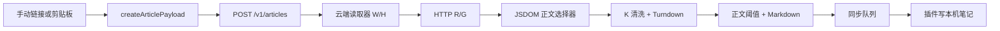

# 逆向来源与复刻范围

取证日期：2026-11-10。目标为用户本机正常运行的「Obsidian同步助手」，appId `wx2d95b0dd592c37d3`，代码包版本13。

目标原始 wxapkg SHA256：`c7ee0758afccf21d414100efe3b2262b0e898d75735bae2c9d4606b6d042ecaa`。
解包后 app-service.js SHA256：`0f47ed401f84885d0bf15e9590da410be6f096bfc7882d1c1a4dc8272dc1842c`。
Craft Anything 分析证据：`ev_85375823eb3a8a7bca5cd9b7e5656d781cd2ef80617d82e8006834fc28527a08`。
格式化证据：`ev_0b573082eb0eb718b8f47e7b8574507e5e5bc22db52491fe6430bbf0786dbd84`。

原小程序包、完整反编译文件、用户凭证与文章全文不在本仓库发布。本仓库代码依据逐函数行为分析编写；保留原始证据哈希以便核对来源。

## 实际调用链

在 v13 的 `app-service.js` 中，`cloudfunctions/obsync-api/index.js` 作为一个 define 模块被一并打包，包含真实读取与转换代码。以下行号针对 Craft 格式化结果：

| 函数或调用 | 行号 | 已观察行为 |
|---|---:|---|
| cloud-config | 2535–2554 | 公共 API 为 `https://ob.agentok.top`，云函数开关为 false |
| readAndSaveClipboard / saveArticle | 5200附近、5436–5505 | 链接规范化，带微信会话提交 `/v1/articles` |
| POST /v1/articles | 4070–4160 | 普通文章调用 `W(url,title)`；rawMaterial HTML 不直接代替抓取 |
| R | 2670–2693 | Node HTTP(S) GET，identity，最多5次重定向，每个请求15秒超时 |
| W/H | 2694–2723 | 获取并解析；只有缺少正文或正文不完整时，等待1200ms重试一次 |
| J | 2725–2783 | JSDOM，微信选择器，元数据，Turndown，正文阈值 |
| K/F | 2784–2840 | 清除广告、导航、二维码、figcaption；候选正文可读性检查 |
| $/G | 2841–2864 | 固定桌面 MicroMessenger UA 与微信 Referer |
| X/V/Y | 2871–2885 | 解析错误、meta 读取、空白归一化 |

### 复刻的核心规则

- 请求头：`user-agent: Mozilla/5.0 (Macintosh; Intel Mac OS X 10_15_7) AppleWebKit/537.36 (KHTML, like Gecko) Chrome/125 Safari/537.36 MicroMessenger`、`referer: https://mp.weixin.qq.com/`、`accept-encoding: identity`。无浏览器 cookie 或微信 token参与直接文章 GET。
- 依次检查 `#js_content`、`.rich_media_content`、`#img-content`，对副本清洗。候选文本至少20字符或含1图。
- 最终 Markdown 去图片、链接标记和常见排版符号后，文本至少60字符，或文本至少20字符且至少2图。
- 标题：og:title → #activity-name → 调用标题 → 默认值；公众号：#js_name → og:article:author → author。使用 nullish 规则，空值并不总是触发后备。
- 作者字段只取 `#meta_content .rich_media_meta_text` 的首个元素；`meta[name=author]` 在原规则中是公众号名称的后备来源，`#js_author_name` 未被该版本读取。缺失时不补造作者。
- 图片使用 data-src → data-original → src；空 data-src 会导致图片被删除，不会继续后备。过滤广告、推荐、二维码和部分占位图片。
- Turndown 7.2.0：ATX 标题、fenced 代码、`-` 列表。默认 Turndown 不提供 GFM 表格插件，本复刻不擅自换成另一种表格算法。
- 末尾追加分隔线和原文链接。原代码虽有“Readability returned…”错误文字及 Readability 依赖声明，实际该分支未调用 Readability。

## 明确差异与证据边界

本地脚本直接获取文章并写文件，不实现微信登录、绑定、队列、ACK 或私有 API 服务。不复制认证凭证，也不依赖原作者线上服务。

新增的运行边界：仅接受 HTTPS 微信文章；重定向限制在微信域名；识别验证/受限页面立即停止；HTML上限20MiB；失败只写状态，不把“解析失败”文本当文章；拒绝覆盖已有输出；静态 DOM 在解析后关闭。这些属于本地封装差异，解析规则保持 v13 行为。

已进行16例逐结果差分，对照私有保留的目标 J/K/F/X/V/Y 原函数。覆盖元数据、空属性、图片、删杂、排版、候选选择与临界长度。差分夹具为合成资料，不是该真实文章的原 HTML。

### 真实单篇验证

2026-11-10，使用最终自包含运行包及 `run.sh`，对用户指定的真实文章进行了在线转换。未传入 `--html`、浏览器 cookie 或微信凭证，也未调用原作者 API。状态为 `ok: true`、`converted`、`input_mode: http`；输出3,753字节，标题和公众号与原保存版一致。

与原小程序保存的 Markdown 对照：移除 frontmatter 后，两份正文去除 Unicode 排版空白均为1,331字符，SHA256均为 `356cd68369cbe0325b22bc62f94e3be9fc8c7c6b7a65841f143c9a22acf03ede`。差异为列表缩进、空行、NBSP和 Markdown 硬换行空格，不是逐字节相同的文件。

元数据方面：`source_url`、`title`、`account`、`parse_status` 一致；本次 `saved_at` 是新保存时间；v13选择器提取到的 `author` 与原保存版不同；本次没有提取到 `published_at`，也不生成原同步系统的 `sync_id`。图片仍为远程链接。

此前 curl 探测曾返回302，不能据此推断最终 Node HTTPS 运行包也必然失败；此次实际运行已成功。成功原因未做网络指纹归因。部署于 Cloudflare 的当前 reader 是否与 v13 打包云函数相同，仍未取得部署源码或完整执行轨迹，不能假设完全等价。此验证只覆盖这一篇指定文章和本机运行环境。
